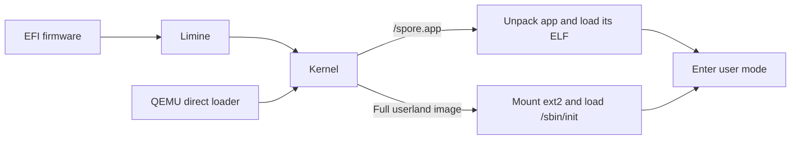

# From boot to the first process

EFI images use Limine to pass a memory map, CPU topology and boot modules to Spore.
For a [direct app launch](../host/direct-boot.md), QEMU loads the kernel and payload into RAM.
Both paths enter the kernel at EL1 and initialize the [page allocator](../memory/pages.md),
[CPUs](cpus.md) and [devices](devices.md).
[Limine handoff](../../kernel/arch/aarch64/limine_boot.c) · [Kernel entry](../../kernel/init/main.c)

The app payload supplies the executable, arguments, environment, working directory and IPv4
settings. In the interactive image, the first process starts [Mycelium](../userland/mycelium.md).
Both paths use the same [ELF loader](elf.md). [Profile selection](../../kernel/init/profile.c) · [Root setup](../../kernel/init/rootfs.c)
